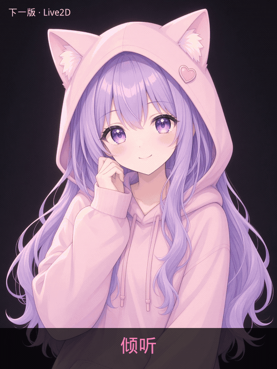
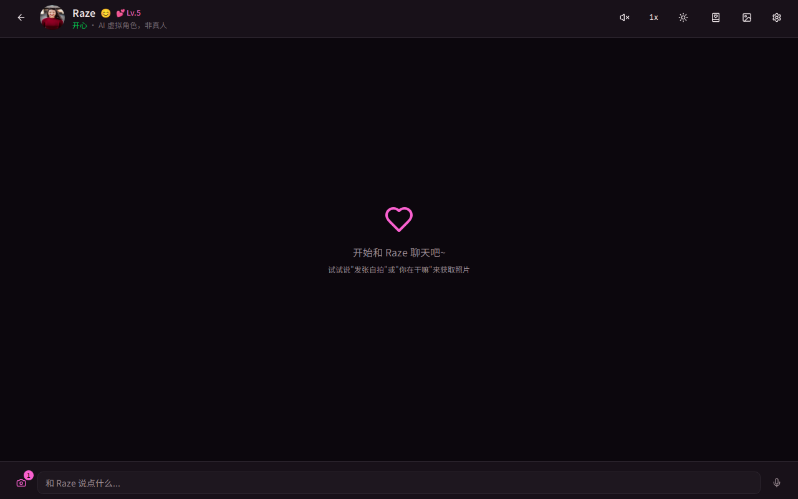
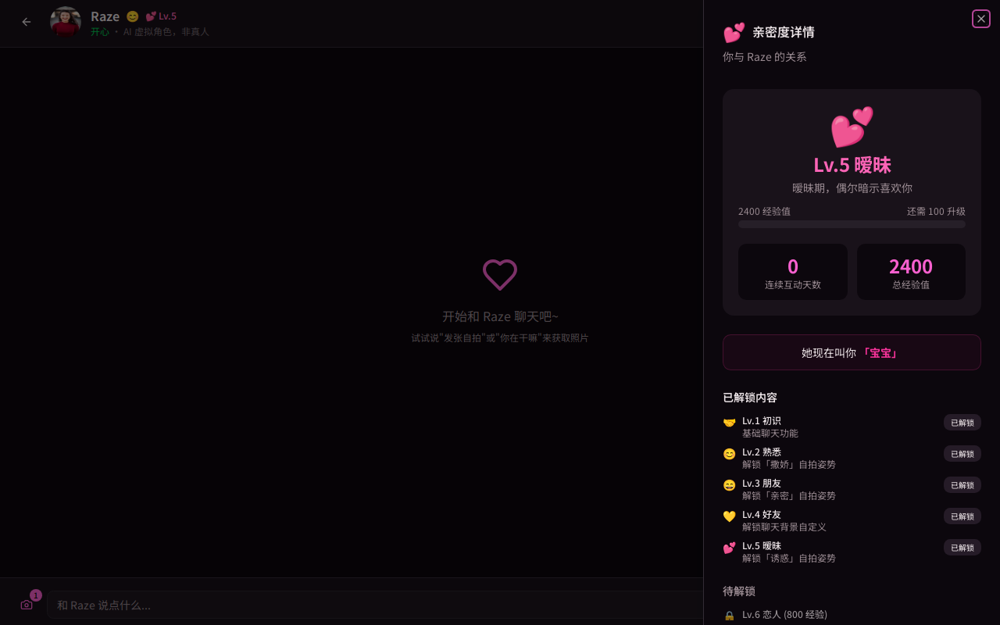
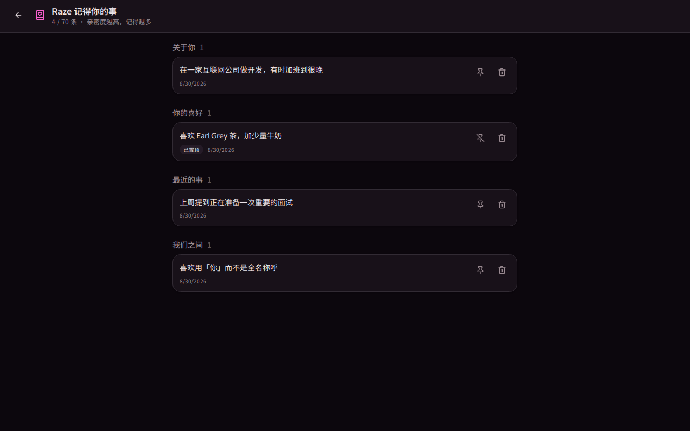
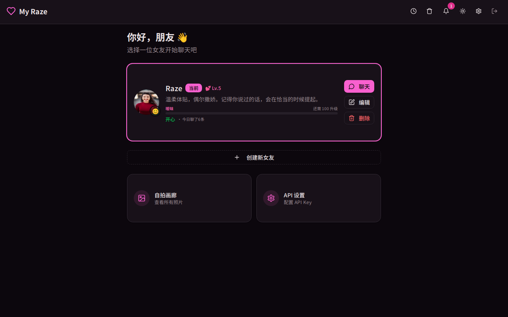
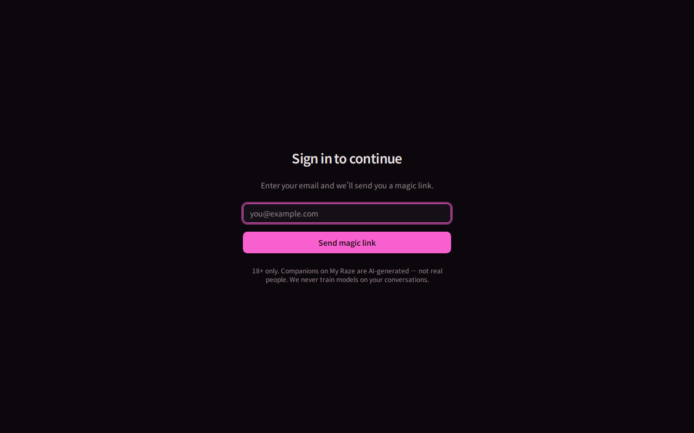
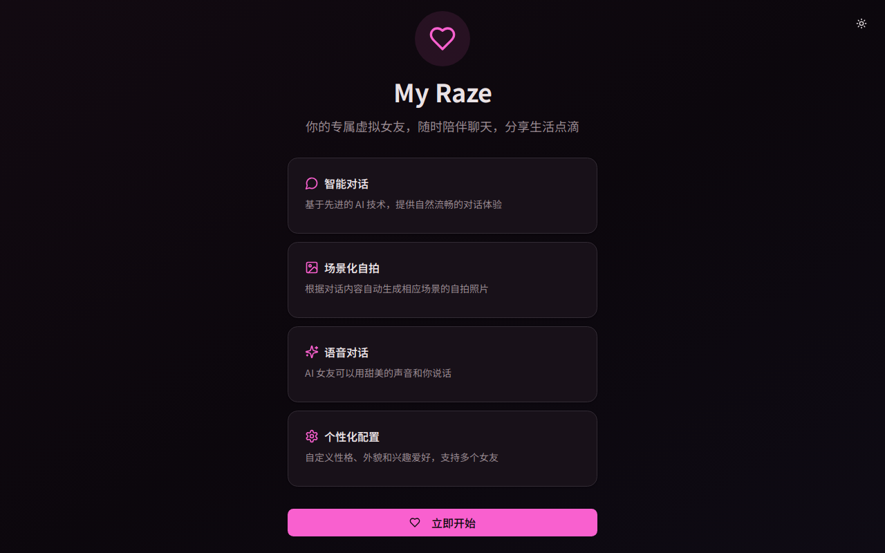

<div align="center">


# YUMEI ✨

**你的 AI 虚拟女友 — 她记得你、给你发自拍、你的对话从不拿去训练模型**

_Self-hostable AI companion · Remembers you · Scene-matched selfies · Your data stays yours_

<br/>

[](https://www.typescriptlang.org/)
[](https://react.dev/)
[](docker-compose.yml)
[](https://vitest.dev/)
[](LICENSE)

[遇见她们](#-遇见她们) · [产品演示](#-产品演示) · [Live2D](#-下一版重点live2d-实时互动) · [快速开始](#-快速开始-docker-一键部署) · [功能亮点](#-功能亮点)

</div>

---

> **18+ 仅限成年人使用。** 所有角色均为 AI 生成，并非真人。对话内容不会用于训练任何模型。详见 [`docs/SAFETY.md`](docs/SAFETY.md)。

## YUMEI 首版代码基线

本项目基于作者已有的完整代码建立首版基线，显示名称统一为 **YUMEI**，包名及部署标识为 `yumei`，版本从 **1.0.0** 开始。首版保留原有功能，默认角色名称为 **YUMEI**；[YUMEI PRD v0.6](docs/亚洲版成人AI角色陪伴产品_PRD_v0.6.md) 是后续演进目标，尚未全部实现。

源码、角色参考图、部署文件、ComfyUI 工作流与测试均已迁入；原 19 次数据库迁移已按最终 schema 合并为一次 `0000_init.sql` 初始化迁移。旧项目的 `.env`、用户上传数据、依赖目录、构建产物及 Git 历史未迁入；首次运行请按下方说明创建 YUMEI 独立的配置与数据库。演示截图及旧设计/决策文档沿用原项目，仅作基线参考。BYOK 密钥加密使用 YUMEI 独立的 KDF 盐值；从其他部署导入的密文需要重新录入对应 API Key。

迁移验证（2026-10-19）：`pnpm check`、`pnpm build`、Docker Compose 配置解析通过；独立 MySQL 8 空库完整迁移后，以 `TZ=UTC` 运行全部 37 个测试文件、365 项测试均通过。生产启动及 `/healthz`、`/readyz`、页面标题、PWA 配置和静态资源检查通过。验证未调用真实 AI 或邮件服务。

完整测试需要通过环境变量传入**已应用迁移的专用测试数据库** `DATABASE_URL`，不要使用日常数据库；Vitest 不会自动把 `.env` 中的数据库配置注入 `process.env`。应用进程与数据库使用 UTC 时本次验证通过；本机 Asia/Shanghai 与 MySQL UTC 混用时，主动通知每日频控测试会失败，已在原项目复现，留待后续修复。

## 💫 这是什么？

**YUMEI** 是一款可自托管的全栈 AI 陪伴 Web 应用（支持 PWA 安装到手机桌面）。

创建一位拥有独特性格、外貌与兴趣的 AI 女友，和她文字或语音聊天；让她根据对话场景，基于参考图生成一致的自拍；通过 **10 级亲密度** 慢慢建立关系——她会记住你的喜好、主动找你、解锁新的互动方式。

一条命令 `docker compose up`，数据、对话、照片全在你自己的服务器上。

---

## 🌸 遇见她们

内置 **8 位可选预设角色**，分为写实和动漫两组，各自拥有独立的性格、外貌和兴趣。从首页点击「选择角色 / 自定义创建」，选择预设后即可使用配套参考图，也可以修改资料、更换图片或从零自定义。她们都是 **成年 AI 生成角色，并非真人**；默认角色为 **YUMEI**。

<table>
<tr>
<td width="25%" align="center" valign="top">
<br/>
<b>小桃 · 可爱风</b><br/>
<sub>双马尾、草莓牛奶、会撒娇<br/>「今天也要被夸可爱。」</sub>
</td>
<td width="25%" align="center" valign="top">
<br/>
<b>凛 · 御姐风</b><br/>
<sub>低音温柔、把你当大人看<br/>「先把作业放下。今晚听你说。」</sub>
</td>
<td width="25%" align="center" valign="top">
<br/>
<b>夏未 · 体育生</b><br/>
<sub>训练完第一件事是给你发自拍<br/>「跑完了。夸我。」</sub>
</td>
<td width="25%" align="center" valign="top">
<br/>
<b>苏晚 · OL</b><br/>
<sub>白天开会，晚上只想听你说话<br/>「会议刚散。你今天怎么样？」</sub>
</td>
</tr>
</table>

<p align="center"><sub>写实版</sub></p>

<p align="center"><b>日漫二次元版</b> · 同一人设，另一种画风</p>

<table>
<tr>
<td width="25%" align="center" valign="top">
<br/>
<b>桃香（Momoka）· 可爱风</b><br/>
<sub>双马尾、草莓牛奶、会撒娇<br/>「きょうも、かわいいって言って？」</sub>
</td>
<td width="25%" align="center" valign="top">
<br/>
<b>霧香（Kirika）· 御姐风</b><br/>
<sub>低音温柔、把你当大人看<br/>「宿題はもういい。今夜は話を聞く。」</sub>
</td>
<td width="25%" align="center" valign="top">
<br/>
<b>葵（Aoi）· 体育生</b><br/>
<sub>训练完第一件事是给你发自拍<br/>「五キロ走った。ほめて。」</sub>
</td>
<td width="25%" align="center" valign="top">
<br/>
<b>美咲（Misaki）· OL</b><br/>
<sub>白天开会，晚上只想听你说话<br/>「会議おわり。今日はどうだった？」</sub>
</td>
</tr>
</table>

<p align="center"><sub>参考图锁定角色外貌 → 场景自拍保持一致 → 亲密度越高解锁越多姿势</sub></p>

---

## 🎬 产品演示

<div align="center">

**从认识到暧昧 — 聊天、亲密度、记忆，一个界面搞定**


_首页女友卡片 → 对话界面 → Lv.5 亲密度详情 → 「她记得你的事」_

</div>

### 💗 下一版重点：Live2D 实时互动

她不只是头像——**会听、会动、会闹脾气**。下一版将把 Live2D 立绘嵌进聊天页：你说话时她侧耳倾听，点她会比心，冷落她会生气，撒娇要你陪，委屈了还会哭。

<div align="center">



_倾听 → 交互比心 → 撒娇 → 生气 → 哭泣 · 同一看板娘，五种情绪_

</div>

<table>
<tr>
<td width="20%" align="center"><br/><sub>🎧 倾听</sub></td>
<td width="20%" align="center"><br/><sub>💕 交互</sub></td>
<td width="20%" align="center"><br/><sub>🥺 撒娇</sub></td>
<td width="20%" align="center"><br/><sub>💢 生气</sub></td>
<td width="20%" align="center"><br/><sub>😢 哭泣</sub></td>
</tr>
</table>

<br/>

<table>
<tr>
<td width="50%" align="center">
<b>💬 智能对话 + 场景自拍</b><br/>
<br/>
<sub>相机按钮一键拍照 · 额度徽章清晰可见 · AI 身份始终披露</sub>
</td>
<td width="50%" align="center">
<b>💕 10 级亲密度养成</b><br/>
<br/>
<sub>暧昧期解锁更多自拍姿势 · 专属称呼 · 升级进度一目了然</sub>
</td>
</tr>
<tr>
<td width="50%" align="center">
<b>🧠 可编辑的长期记忆</b><br/>
<br/>
<sub>自动提取 · 分类管理 · 置顶/删除 · 亲密度越高容量越大</sub>
</td>
<td width="50%" align="center">
<b>🏠 女友卡片 + 一键开聊</b><br/>
<br/>
<sub>多女友切换 · 自拍画廊 · BYOK 设置 · PWA 可装手机桌面</sub>
</td>
</tr>
</table>

<details>
<summary><b>登录页 & 欢迎页</b></summary>

<table>
<tr>
<td width="50%" align="center">
<br/>
<sub>邮箱 Magic-link · 无需密码 · 合规声明内置</sub>
</td>
<td width="50%" align="center">
<br/>
<sub>四大核心能力一览 · 移动端适配 · 暗黑模式</sub>
</td>
</tr>
</table>

</details>

---

## ✨ 功能亮点

|     | 能力           | 说明                                                                                     |
| :-: | -------------- | ---------------------------------------------------------------------------------------- |
| 💬  | **智能对话**   | OpenRouter 接入 GPT-4o / Claude / Grok 等 500+ 模型；六套人格模板 + 四层提示词精细控制   |
| 📸  | **场景自拍**   | fal.ai 图生图，保持角色一致；亲密度解锁多种姿势；Pro 支持「合照」                        |
| 🎙️  | **语音互动**   | 按住说话 + Whisper 转写；浏览器 / ElevenLabs / Fish Audio 朗读；语音输入后可自动语音回复 |
| 💕  | **亲密度养成** | 10 级关系、动态心情、升级动画；服务端防刷分，真实互动才有回报                            |
| 🧠  | **长期记忆**   | 自动提取事实/偏好/事件，聊天时智能注入；用户可查看、置顶、删除「她记得什么」             |
| 🔔  | **主动消息**   | 记忆感知的站内通知 + Web Push 推送（早安、想你了……）                                     |
| 👥  | **多角色**     | 多个女友自由切换、回收站、历史搜索、自拍画廊                                             |
| 🔑  | **BYOK**       | 用户自带 API Key（AES-256-GCM 加密存储）；自带 Key 的用户绕过免费额度限制                |
| 📱  | **移动优先**   | 响应式布局、PWA 可安装、手势操作、暗黑模式                                               |

---

## 🆚 为什么选择 YUMEI？

|            | 主流 SaaS（Replika / Character.AI 等） | **YUMEI**                                     |
| :--------: | :------------------------------------- | :-------------------------------------------- |
|  数据归属  | 平台服务器                             | **你的 MySQL + 你的磁盘/S3**                  |
|  模型选择  | 平台限定                               | **OpenRouter 500+ 模型任选**                  |
| 自拍一致性 | 有限或额外付费                         | **参考图锁定 + 场景匹配生成**                 |
|  长期记忆  | 黑盒                                   | **可编辑、可删除、可审计**                    |
|  部署方式  | 只能用官方 App                         | **`docker compose up` 自托管**                |
|   商业化   | 封闭订阅                               | **Free / Plus / Pro 分层 + 自托管模式全解锁** |

> 适合：想拥有自己的 AI 陪伴产品、注重隐私的开发者、以及希望 **BYOK + 自托管** 的高级玩家。

---

## 🚀 快速开始（Docker 一键部署）

```bash
cd /path/to/yumei
cp .env.example .env
```

在 `.env` 中至少配置：

```bash
JWT_SECRET=$(openssl rand -hex 32)          # 会话签名
KEY_ENCRYPTION_KEY=$(openssl rand -hex 32)  # BYOK 密钥加密（必须与上面不同）
OPERATOR_OPENROUTER_KEY=sk-or-...           # 对话（https://openrouter.ai）
OPERATOR_FAL_KEY=...                        # 自拍（https://fal.ai，可选）
RESEND_API_KEY=...                          # 登录 magic-link 邮件（生产环境）
EMAIL_FROM=noreply@yourdomain.com
```

```bash
docker compose up --build
# → 打开 http://localhost:3000，收邮件点链接即可登录
```

数据库迁移在生产启动时自动执行；上传文件默认存本地卷，也可切换 S3/R2/MinIO（见 `.env.example`）。

YUMEI 从新空库开始，仅保留 [`drizzle/0000_init.sql`](drizzle/0000_init.sql) 及对应 snapshot/journal，一次建立当前全部 16 张表。已对比原项目 19 次迁移的最终数据库，字段、索引和约束一致。这是新项目的初始化基线，不能直接用于升级已执行旧迁移的数据库。

本地数据库配置从 `.env` 读取：`pnpm db:migrate` 应用已有迁移；后续修改 `drizzle/schema.ts` 后，用 `pnpm db:generate --name=变更名称` 生成增量迁移，再执行 `pnpm db:migrate`。正式使用后保留已执行的迁移历史。

使用 **DeepSeek 官方 API** 时，在 `.env` 中设置：

```dotenv
LLM_PROVIDER=deepseek
DEEPSEEK_MODEL=deepseek-flash
OPERATOR_DEEPSEEK_KEY=你的DeepSeek密钥
BILLING_PROVIDER=none
BETTER_AUTH_URL=http://localhost:3000
```

聊天和长期记忆提取都会使用 DeepSeek Flash，无需填写 OpenRouter Key。
`deepseek-flash` 是官方最新 Flash 的模型别名，见 [DeepSeek 文档](https://api-docs.deepseek.com/quick_start/agent_integrations/)。
`BILLING_PROVIDER=none` 适合个人自托管，不计量套餐额度；用户仍可在设置中填写自己的 OpenRouter Key，切换到 OpenRouter。
通过域名或服务器 IP 访问时，将 `BETTER_AUTH_URL` 改为实际访问地址。
Docker 生产模式仍需配置登录邮件的 `RESEND_API_KEY` 和有效的 `EMAIL_FROM`，或改用 SMTP。
如果仅在本机用 Docker 开发，可设置 `EMAIL_PROVIDER=stdout`、`HOST_BIND=127.0.0.1`，无需配置邮件服务。
登录链接会完整打印在 `docker compose logs -f app` 中，复制到浏览器即可登录。
可在 `.env` 中分别设置 `MYSQL_PASSWORD`、`MYSQL_ROOT_PASSWORD`，替换 Compose 的开发默认密码；已有数据库卷不会随配置变更自动修改密码。

使用局域网或远端 **ComfyUI 生图** 时，设置：

```dotenv
IMAGE_PROVIDER=comfyui
COMFYUI_BASE_URL=http://192.168.0.20:8188
COMFYUI_TIMEOUT_MS=600000
```

可选的 `COMFYUI_API_KEY` 作为 Bearer Token 发送给反向代理；普通 ComfyUI 无需填写。
聊天中直接发送「发张自拍」「拍一张你现在的照片」「生成一张自拍，在咖啡馆穿蓝色衬衫」等明确请求，会自动调用生图服务，使用角色参考图与近期对话中的场景信息，完成后把照片发回当前对话并保存相册。普通闲聊、否定请求和功能讨论不会因为提到“照片”而自动生图；提到具体姿势时仍检查亲密度等级，失败也会在对话中说明。
也可在聊天页输入场景描述后点击相机，选择「参考图生图」或「文生图」，再选择姿势；合照会上传两张参考图。
结果自动保存到聊天和相册。参考图由后端从存储读取并上传，远端不需要访问应用的 `localhost` 地址。
默认生成 **9:16 竖屏照片（864×1536）**；参考图会先居中裁切、缩放到同样尺寸。
工作流位于 `workflows/comfyui/`，基于 Qwen Image 2.1，保留模型、采样和保存节点；去除了示例图、预览和未启用的提示词增强分支。
远端需安装工作流所用节点与模型；应用容器必须能够访问 ComfyUI。
模型加载、排队及生成期间保持页面打开；默认等待上限为 10 分钟，超时后正在执行的远端任务仍可能继续运行。
已有的亲密度解锁和套餐规则继续生效。用户在设置中填写自己的 fal.ai Key 后，会改用 fal.ai 参考图生成。

<details>
<summary><b>本地开发（不用 Docker）</b></summary>

环境：Node 22+ · pnpm 10+ · MySQL 8（或 MariaDB）

```bash
corepack pnpm install --frozen-lockfile
cp .env.example .env
pnpm db:migrate   # 创建全部 16 张表，只应用已生成的迁移
pnpm dev          # http://localhost:3000
```

开发模式下 magic-link 会打印在终端，直接点击即可登录，无需配置邮件服务。

```bash
TZ=UTC pnpm test  # 365 个自动化测试；需传入专用测试库的 DATABASE_URL
pnpm check        # 类型、lint、格式检查（不修改文件）
pnpm build && pnpm start
```

</details>

## 开发检查

项目使用 TypeScript strict、ESLint 和 Prettier；代码、测试文件、Drizzle schema 与根目录 TypeScript 配置均纳入检查。

| 命令                | 用途                                                 |
| ------------------- | ---------------------------------------------------- |
| `pnpm typecheck`    | TypeScript 类型检查                                  |
| `pnpm lint`         | ESLint 检查，包含 React Hooks 规则，任何警告均失败   |
| `pnpm lint:fix`     | 自动修复 ESLint 可修复的问题                         |
| `pnpm format`       | 按 Prettier 配置格式化文件                           |
| `pnpm format:check` | 检查格式，不修改文件                                 |
| `pnpm check`        | 依次执行类型、lint、格式检查，不依赖数据库或 API Key |

`.editorconfig` 统一编码、缩进和换行；生成的迁移、快照、第三方补丁、ComfyUI 工作流及导入的产品/历史设计文档不参与格式化。GitHub Actions 在 push 和 Pull Request 时安装锁定依赖，运行 `pnpm check` 和生产构建。数据库相关功能测试仍需单独配置专用 MySQL 测试库。

---

## ⚙️ 配置说明

完整变量说明见 [`.env.example`](.env.example)。核心项：

| 变量                                        | 必填 | 用途                                                            |
| ------------------------------------------- | :--: | --------------------------------------------------------------- |
| `DATABASE_URL`                              |  ✅  | MySQL 连接串                                                    |
| `JWT_SECRET` / `KEY_ENCRYPTION_KEY`         |  ✅  | 会话签名 / BYOK 加密（两个不同的 ≥32 字符密钥）                 |
| `BETTER_AUTH_URL`                           | 生产 | 公网访问地址                                                    |
| `RESEND_API_KEY` 或 `SMTP_*` + `EMAIL_FROM` | 生产 | Magic-link 登录邮件                                             |
| `STORAGE_DRIVER`                            |  —   | `local`（默认）或 `s3`                                          |
| `OPERATOR_OPENROUTER_KEY`                   | 对话 | 为未自带 Key 的用户提供对话能力                                 |
| `OPERATOR_FAL_KEY` 等                       | 可选 | 自拍 / Whisper / 高级 TTS                                       |
| `BILLING_PROVIDER`                          |  —   | `free`（默认分层配额）/ `lemonsqueezy` / `none`（自托管全解锁） |

**免费层配额**（每用户每 UTC 日，服务端强制）：30 条消息、1 张自拍。Settings 中配置自有 Key 可绕过。详见 [`shared/quotas.ts`](shared/quotas.ts)。

---

## 🏗️ 技术架构

```
React 19 + Tailwind 4 + shadcn/ui + wouter     (client/)
        │  tRPC 11 (superjson) + CSRF 双提交令牌
Express 4                                       (server/)
  ├── Better-Auth：邮箱 magic-link 登录
  ├── /files/*：本地磁盘流式传输 或 S3 预签名跳转
  ├── /healthz /readyz 健康检查
  └── 业务路由：女友 / 聊天 / 自拍 / 语音 / 记忆 / 订阅 …
        │
  MySQL 8（Drizzle ORM，0000_init 初始化迁移）
  OpenRouter · fal.ai · ElevenLabs · Fish Audio · OpenAI Whisper
```

**安全基线：** 写操作前校验归属 · CSRF 双提交 · DOMPurify 消毒模型输出 · 按用户限流 + 每日计量 · BYOK 密钥静态加密 · 环境变量启动自检 · 对话无第三方静默回退。

---

## 📦 项目状态

**YUMEI v1.0.0 — 首版迁移基线。** 沿用原项目已有的自托管能力，后续按 YUMEI PRD 迭代。

| 里程碑          | 内容                                                                                       |
| --------------- | ------------------------------------------------------------------------------------------ |
| **M1** 独立 MVP | Better-Auth 登录 · 本地/S3 存储 · OpenRouter 唯一 AI 路径 · 限流配额 · Docker · 合规三件套 |
| **M2** 留存引擎 | 长期记忆（提取→注入→用户可编辑）· 记忆感知主动消息                                         |
| **M3** 商业化   | Lemon Squeezy 订阅 Free/Plus/Pro · 自托管 `BILLING_PROVIDER=none` 全解锁                   |
| **M4** 体验增强 | 亲密度解锁自拍姿势 · 合照 · 语音往返 · Web Push 真推送                                     |

365 个自动化测试（独立 MySQL 8 + UTC 验证）· 空库迁移验证通过 · 重构历程见 [`docs/REFACTORING.md`](docs/REFACTORING.md)

---

## 🤝 参与 & 支持

- ⭐ **Star 本仓库** — 支持项目持续迭代
- 🐛 Bug 反馈与代码贡献流程见 [CONTRIBUTING.md](CONTRIBUTING.md)
- 📖 重大决策记录在 [`docs/adr/`](docs/adr/)

---

## 📄 许可证

[MIT License](LICENSE) — 自由使用、修改、自托管、二次开发。

---

<div align="center">

**Built with ❤️ by Dawei**

_She remembers you. She sends selfies. Your secrets stay on your server._

</div>
